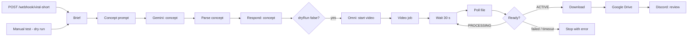

# Viral Shorts Generator (n8n)

Give it a topic and get a short-form video concept back: hook, title, caption with hashtags, and a scene prompt.
If you ask for it, the workflow also renders a vertical 9:16 clip with Google's Gemini Omni video model, saves it to Google Drive and posts it to a Discord channel for review.

**Dry run by default.** The workflow renders a video only when the request contains `"dryRun": false`, because video generation costs money.



## What it does

1. **Concept.** Gemini 2.5 Flash writes a curiosity hook, a title of up to 70 characters, and a caption that ends with a question or call to action, plus 3–5 hashtags. It also writes one continuous-shot scene, since a single generated clip has no cuts. The prompt rules out real people, logos, brands, copyrighted characters, unsafe content and on-screen text.
2. **Instant answer.** The webhook replies straight away with the concept, so the caller doesn't have to wait for the video.
3. **Video (optional).** Gemini Omni renders a 720p 9:16 clip. The workflow checks the file every 30 s, for up to about 15 minutes, until it is ready.
4. **Review.** The clip goes to Google Drive, and a Discord message with the title, hook, caption and link asks you to review it. Nothing is published automatically.

## Setup

1. Credentials:
   - **Google Gemini (PaLM) API** ([get a key](https://aistudio.google.com/apikey)). Video needs a billing-enabled project.
   - **Google Drive OAuth2**.
   - **Discord Bot (OAuth2)**.
2. **Workflows → Import from file** → [`Viral_Shorts_Generator.json`](Viral_Shorts_Generator.json), then select the credentials.
3. Replace the placeholders:
   - `YOUR_DRIVE_FOLDER_ID` in *Upload to Google Drive*;
   - `YOUR_DISCORD_SERVER_ID` and `YOUR_DISCORD_CHANNEL_ID` in *Discord: Review*.

   n8n refuses to run the workflow while these are placeholders.
4. **Test workflow** runs a dry run with a sample topic.

## Usage

Concept only (free apart from one cheap text call):

```bash
curl -X POST https://<your-n8n>/webhook/viral-short \
  -H "Content-Type: application/json" \
  -d '{"topic": "3 automation habits that save a freelancer 5 hours a week"}'
```

Concept and video:

```bash
curl -X POST https://<your-n8n>/webhook/viral-short \
  -H "Content-Type: application/json" \
  -d '{"topic": "Why your morning routine fails", "style": "cozy anime, warm light", "seconds": 8, "dryRun": false}'
```

Optional fields:
- `audience`;
- `style`;
- `language` (title, hook and caption);
- `seconds`, from 4 to 10 (default 8).

The response is `{ ok, rendering, title, hook, caption, videoPrompt }`.

## Development

[`generate_workflow.py`](generate_workflow.py) builds the JSON. `python test_workflow.py` runs 10 tests:
- structure and the poll loop;
- a check that no secrets are in the JSON;
- the dry-run default and input limits;
- concept parsing, hashtag clean-up and the video request;
- finding the Omni file and the review message.

The Code-node logic in these tests runs in Node.js.

## Costs and limits

- Concept: one Gemini 2.5 Flash call, a fraction of a cent.
- Video: Gemini Omni Flash costs roughly $0.10 per second of output, about $1 per 8–10 s clip in our runs. Check current pricing before you put it on a schedule.
- One continuous shot per clip. For multi-scene videos, render several concepts and edit them together.
- Generated media follows Google's usage policies, and the request can be refused. A refusal stops the run with the reason.

## Status

Verified on 2026-10-27 on a self-hosted n8n:
- **Dry run:** a real Gemini call returned a valid concept.
- **Render path:** ran end to end to the Discord review step, with the Omni, Drive and Discord outputs pinned, so no paid video was rendered. The Omni request and poll logic are the same as in a production workflow that rendered clips successfully.

10 local tests pass.

## License

MIT, see [LICENSE](LICENSE). Built by [CyberResonance](https://cyberresonance.io).
